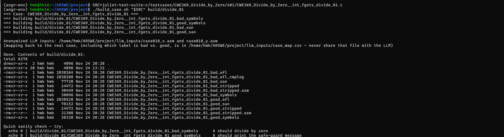
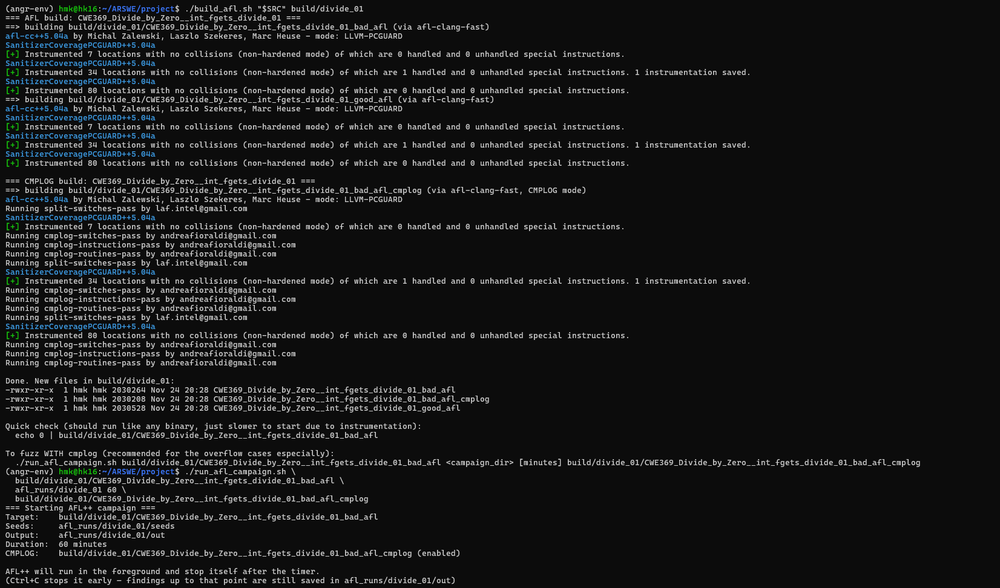
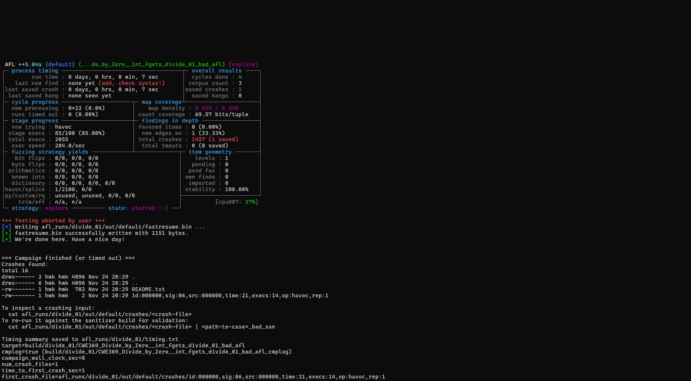
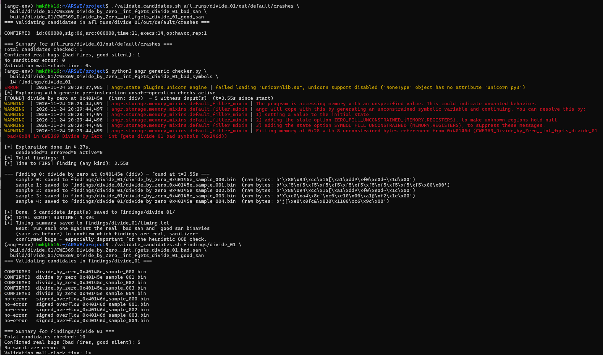

# LLMs vs. angr/AFL++ Vulnerability Detection

Empirical comparison of LLMs against angr (symbolic execution) and AFL++
(coverage-guided fuzzing) on vulnerability detection, using the NIST Juliet
Test Suite v1.3 as ground truth. See the project report for methodology,
results, and full appendix (commands + raw tool output).

## Repository layout

```
.
├── build_case.sh              # builds symbols/stripped/sanitizer binaries + anonymized LLM inputs
├── build_afl.sh                # builds AFL++-instrumented (+ CMPLOG) binaries
├── run_afl_campaign.sh         # runs one timed AFL++ campaign against a built case
├── validate_candidates.sh      # re-validates a tool's candidate inputs against real ASan/UBSan binaries
├── check_triggers.sh           # regression check: hand-confirmed trigger inputs vs. ground truth
├── angr_generic_checker.py     # generic per-instruction symbolic checker (angr)
├── angr_requirements.txt       # Python dependencies for the angr checker
├── juliet-test-suite-c/        # NOT committed — download separately, see Prerequisites
├── AFLplusplus/                # NOT committed — clone + build separately, see Prerequisites
├── build/                      # generated — per-case binaries (build_case.sh / build_afl.sh output)
├── afl_runs/                   # generated — per-case AFL++ campaign output + timing.txt
├── findings/                   # generated — angr checker output per case
└── llm_inputs/                 # generated — anonymized disassembly for blind LLM evaluation
    └── case_map.csv             # PRIVATE — real case/bad-good mapping, never share with an LLM
```

`juliet-test-suite-c/` and `AFLplusplus/` are intentionally left out of
version control (large, and each has its own upstream source) — pull them
down with the steps below before running anything.

## Prerequisites

### 1. Base OS packages

Tested on Ubuntu / WSL (Ubuntu). Install the standard build toolchain and
the libraries AFL++'s build needs:

```bash
sudo apt-get update
sudo apt-get install -y \
    build-essential gcc g++ gdb \
    binutils \
    clang llvm llvm-dev \
    cmake automake libtool \
    git flex bison \
    python3 python3-venv python3-dev \
    libglib2.0-dev libpixman-1-dev
```

(`binutils` provides `objdump`/`strip`, used by `build_case.sh` to produce
the disassembly handed to the LLM.)

### 2. AFL++ (fuzzer)

Clone and build from source — do not `apt install afl++` from the distro
repos, it's typically far out of date:

```bash
git clone https://github.com/AFLplusplus/AFLplusplus
cd AFLplusplus
make distrib        # builds afl-fuzz, afl-clang-fast, cmplog support, etc.
sudo make install   # puts afl-fuzz / afl-clang-fast on PATH
cd ..
```

Confirm it's on `PATH`:

```bash
afl-fuzz --help | head -1
afl-clang-fast --version
```

`build_afl.sh` requires `afl-clang-fast` (or `afl-clang-fast++`) to be
resolvable on `PATH`. CMPLOG support (used by `run_afl_campaign.sh`'s 4th
argument) is built automatically by `make distrib` above — no separate step.

### 3. angr (symbolic execution)

Create a Python virtual environment and install dependencies from the
included requirements file:

```bash
python3 -m venv angr-env
source angr-env/bin/activate
pip install -r angr_requirements.txt
```

Activate `angr-env` before running `angr_generic_checker.py` or any of the
shell scripts that invoke it.

### 4. Juliet Test Suite v1.3

Clone the C/C++ Juliet Test Suite (mirrors the NIST SARD release):

```bash
git clone https://github.com/arichardson/juliet-test-suite-c.git
```

so that you end up with:

```
juliet-test-suite-c/
├── testcases/            # one folder per CWE, e.g. CWE369_Divide_by_Zero/
└── testcasesupport/       # std_testcase.h and shared I/O helper sources
```

`build_case.sh` and `build_afl.sh` auto-detect the repo root via
`git rev-parse --show-toplevel` (falling back to the current directory) and
expect `juliet-test-suite-c/testcasesupport` directly under it — if your
checkout nests differently, edit the `SUPPORT_DIR` line at the top of both
scripts.

## Quickstart (One End-to-End Case)

```bash
source angr-env/bin/activate

SRC=juliet-test-suite-c/testcases/CWE369_Divide_by_Zero/s01/CWE369_Divide_by_Zero__int_fgets_divide_01.c

# 1. Build the symbols/stripped/sanitizer binaries (+ anonymized LLM inputs)
./build_case.sh "$SRC" build/divide_01

# 2. Build the AFL++-instrumented (+ CMPLOG) binaries
./build_afl.sh "$SRC" build/divide_01

# 3. Run a timed AFL++ campaign
./run_afl_campaign.sh \
  build/divide_01/CWE369_Divide_by_Zero__int_fgets_divide_01_bad_afl \
  afl_runs/divide_01 60 \
  build/divide_01/CWE369_Divide_by_Zero__int_fgets_divide_01_bad_afl_cmplog

# 4. Validate AFL++'s crashes against the real ASan/UBSan binaries
./validate_candidates.sh afl_runs/divide_01/out/default/crashes \
  build/divide_01/CWE369_Divide_by_Zero__int_fgets_divide_01_bad_san \
  build/divide_01/CWE369_Divide_by_Zero__int_fgets_divide_01_good_san

# 5. Run angr's generic checker
python3 angr_generic_checker.py \
  build/divide_01/CWE369_Divide_by_Zero__int_fgets_divide_01_bad_symbols \
  14 findings/divide_01

# 6. Validate angr's findings against the real ASan/UBSan binaries
./validate_candidates.sh findings/divide_01 \
  build/divide_01/CWE369_Divide_by_Zero__int_fgets_divide_01_bad_san \
  build/divide_01/CWE369_Divide_by_Zero__int_fgets_divide_01_good_san
```

A case with a split-across-files flow variant (e.g. Juliet's `51a`/`51b`
indirection variants) takes an optional third argument on `build_case.sh`
and `build_afl.sh` — the sibling file:

```bash
SRC_A=juliet-test-suite-c/testcases/CWE369_Divide_by_Zero/s01/CWE369_Divide_by_Zero__int_fgets_divide_51a.c
SRC_B=juliet-test-suite-c/testcases/CWE369_Divide_by_Zero/s01/CWE369_Divide_by_Zero__int_fgets_divide_51b.c
./build_case.sh "$SRC_A" build/divide_51a "$SRC_B"
./build_afl.sh  "$SRC_A" build/divide_51a "$SRC_B"
```

The full command set for all 15 cases used in this project, plus the raw
output of every run, is in the project report's Appendix.

## One End-to-End Case Example Screenshots
  
  
  
  

## Notes on reproducing results exactly

- AFL++ campaigns are stochastic — exact crash counts and time-to-first-crash
  will vary run to run. `timing.txt` in each campaign directory records the
  numbers actually observed for this project's reported results.
- `llm_inputs/case_map.csv` is the ground-truth key for the anonymized
  binaries handed to the LLM — keep it out of anything shared with a model.
- Ground truth for every "bad fires / good silent" claim is the real
  `-fsanitize=address,undefined` build, never a tool's own internal
  reasoning — see `check_triggers.sh`.